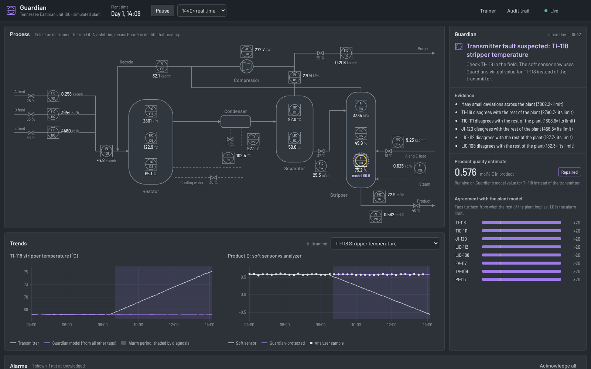
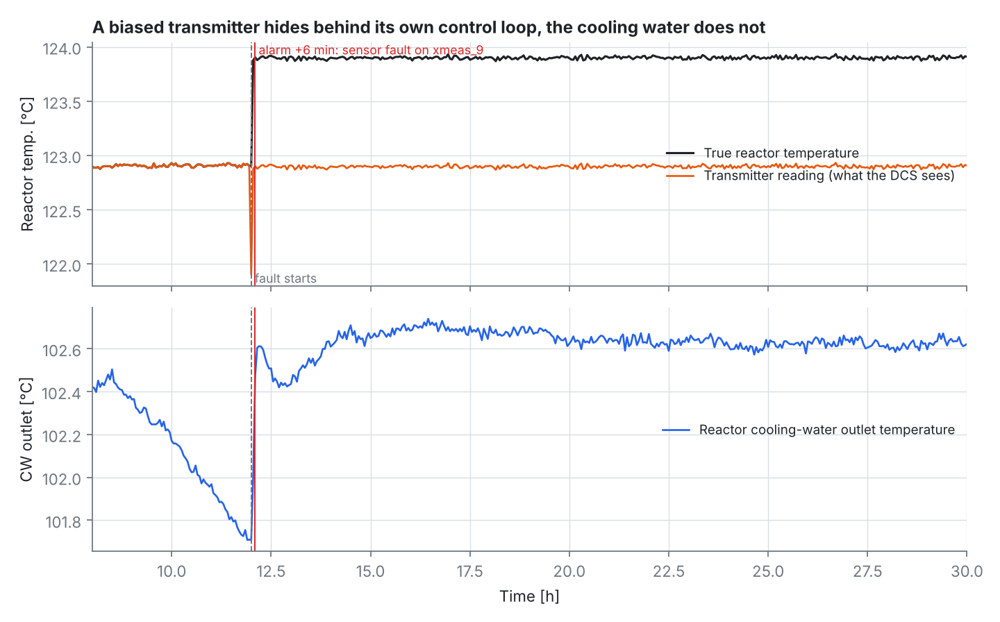
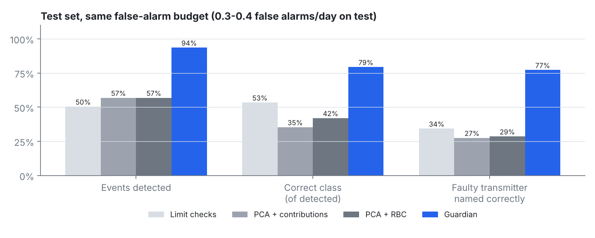
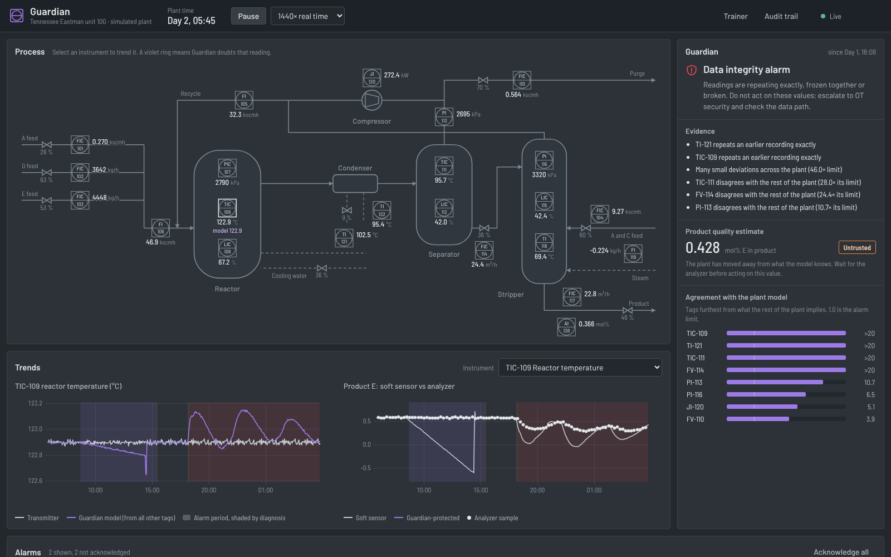
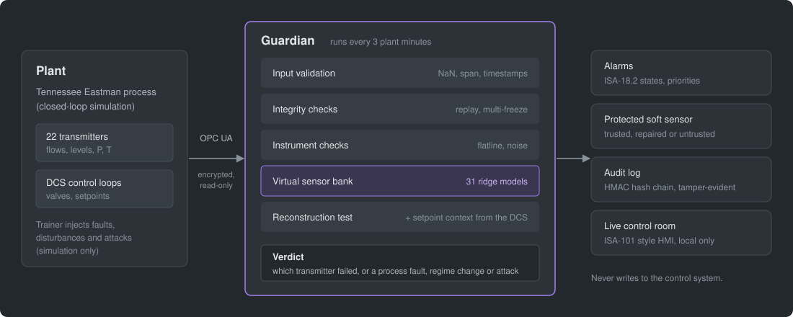

# Industrial AI Guardian

**Know when your process models can be trusted.** Guardian watches the
transmitters that an industrial soft sensor depends on and, every time
something goes wrong, tells the operator whether a transmitter failed (and
which one), the process really changed, the plant left its validated range,
or the data itself is under attack.

[](https://github.com/Tejascodz/industrial-ai-guardian/actions/workflows/ci.yml)




<sub>The live control room during a stripper temperature transmitter drift.
Guardian rings TI-118 on the process diagram and names it. It keeps the
product-quality estimate on its model value: the protected estimate (violet)
stays on the analyzer samples (dots) while the raw one (grey) drifts away.</sub>

## The problem

A soft sensor estimates something that is hard to measure, such as product
purity, from the flows, temperatures, pressures and levels around it. When one
of those transmitters goes bad, the soft sensor quietly goes bad with it.

Inside a control loop it is worse: the controller holds the faulty reading at
its setpoint and moves the *real* process instead. The broken transmitter
looks perfectly normal on the DCS.



<sub>The reactor temperature transmitter starts reading 1 °C low. The reading
stays on setpoint; the real reactor runs 1 °C hotter, which the cooling-water
outlet temperature reveals.</sub>

## What Guardian does

| Verdict | Meaning | What happens to the soft sensor |
|---|---|---|
| **Transmitter fault**, with the tag | One instrument disagrees with what the rest of the plant implies | Out-of-loop transmitter: **repaired** with Guardian's virtual value. In-loop transmitter: **untrusted** |
| **Process fault** | The transmitters agree with each other; the plant really changed | Untrusted |
| **Regime change** | Operators moved a setpoint outside the validated range | Untrusted |
| **Integrity attack** | Readings replayed, frozen together or broken | Untrusted; escalate to OT security |

Guardian is a read-only layer beside the control system. It never writes to
the plant.

## Results

288 test runs of a closed-loop Tennessee Eastman plant, with seeds unseen
during development. All methods run at the same false-alarm budget.

| Method | False alarms / day | Events detected | Median delay | Correct class | Faulty transmitter named | Plant trips warned |
|---|---|---|---|---|---|---|
| Limit checks (per-tag DCS alarms) | 0.30 | 50 % | 1.45 h | 53 % | 34 % | 16 / 20 |
| PCA, T² / SPE + contribution plots | 0.40 | 57 % | 1.45 h | 35 % | 27 % | 17 / 20 |
| PCA + reconstruction-based contributions | 0.40 | 57 % | 1.45 h | 42 % | 29 % | 17 / 20 |
| **Guardian** | **0.35** | **94 %** | **0.30 h** | **79 %** | **77 %** | **20 / 20** |



**Inside control loops is where classical isolation breaks:**

| Faults on transmitters... | PCA + RBC: detected / named | Guardian: detected / named |
|---|---|---|
| outside any control loop (72 runs) | 46 % / 31 % | **100 % / 93 %** |
| inside a control loop (104 runs) | 56 % / 4 % | **95 % / 63 %** |

**The soft sensor stays honest.** For faults on out-of-loop transmitters, its
error drops from 0.089 to **0.014** mol% (normal: 0.010). 99.2 % of all bad
estimates (above 3× normal error) were made while Guardian had flagged the
soft sensor.

**Cyber attacks:** 42 attacks, including Stuxnet-style replays with a hidden
valve attack.

| | Limit checks | PCA + RBC | Guardian |
|---|---|---|---|
| Detected | 88 % | 98 % | **100 %** |
| Median detection delay (over attack types) | 40 min | 32 min | **9 min** |
| Recognised as an attack | n/a | n/a | **50 %** |

Guardian recognises every careless replay and link freeze as an attack. A
careful attacker who adds noise, or a slow coordinated bias, is still
detected, but is reported as a fault. No data-driven monitor can prove
intent.

Full benchmark design, ablations, per-type results and a reproduction on a
second machine: [docs/benchmark.md](docs/benchmark.md).

## Quick start

You need Python 3.11+, a C++17 compiler (`xcode-select --install` on macOS,
`build-essential` on Linux) and about 10 minutes.

```bash
git clone https://github.com/Tejascodz/industrial-ai-guardian.git
cd industrial-ai-guardian
python3 -m venv .venv && source .venv/bin/activate
pip install -e ".[dev]"
make -C sim                        # build the closed-loop plant simulator
pytest                             # 41 tests
python scripts/generate_data.py    # simulate 514 plant runs into data/
python -m dashboard                # open the live control room
```

To reproduce every number and figure:

```bash
python scripts/run_benchmark.py    # results/benchmark_summary.csv, attack_summary.csv
python scripts/run_softsensor.py   # results/softsensor_summary.csv
python scripts/make_figures.py     # docs/figures/
```

## Live control room

`python -m dashboard` runs the real simulator in closed loop, at 90× to 1440×
real time, with Guardian analysing every sample. The **Trainer** panel lets
you:

- inject transmitter faults (bias, drift, stuck, noise)
- start any of the 20 standard process disturbances
- launch replay, freeze or stealth attacks
- move setpoints
- reveal the ground truth, to check Guardian's call against what you injected



<sub>A replay attack. TIC-109 replays old readings and sits on its setpoint
while a hidden valve attack moves the real reactor. Guardian's model of
TIC-109 (violet) shows the swings the transmitter hides, and raises a data
integrity alarm.</sub>

**Design:**
- It follows ISA-101 high-performance HMI practice: a grey plant, colour only
  for abnormal states, and one extra hue (violet) for measurement doubt.
- Instruments are drawn as ISA-5.1 symbols.
- Alarms follow the ISA-18.2 states.
- Every alarm and action is written to a tamper-evident audit trail.

## How it works



1. **Virtual sensor bank.** 31 ridge-regression models, each predicting one
   tag from all the *other* tags, learned from normal history. A faulty
   transmitter cannot vouch for itself.
2. **Instrument and integrity checks.** A stuck transmitter goes flat. A
   noisy one shows noise no related tag shares. Replayed data repeats
   exactly. A lost link freezes several tags at the same moment.
3. **Diagnosis by reconstruction.** For each transmitter, Guardian swaps in
   its virtual value and checks whether that one swap explains every other
   deviation.
4. **DCS context.** Setpoint moves tell a regime change ("the operators did
   it") apart from a process fault ("it happened to them").
5. **Alarm discipline.** Persistence, debouncing and a fixed false-alarm
   budget, so operators are not flooded.

Details and the known failure modes: [docs/method.md](docs/method.md).

## Security

| Layer | Control |
|---|---|
| Plant connection | OPC UA, SignAndEncrypt only. Mutual certificate authentication. A server-side read-only ruleset refuses writes even from a trusted client. |
| Input | Schema, NaN, instrument-span and timestamp validation before any model sees the data |
| Data integrity | Replay, simultaneous-freeze and broken-feed detection |
| Models | No pickle. HMAC-signed SHA-256 manifest; tampered or unsigned models are refused |
| Audit | HMAC hash-chained log of every alarm, diagnosis change and action |
| Dashboard | Local only. Random access token. Origin and host checks. Strict command schema with rate limits. Content-Security-Policy with no third-party code. |
| Supply chain | Pinned dependencies; `pip-audit` and `bandit` clean, also run in CI |

Threat model, IEC 62443 mapping and residual risks:
[docs/security.md](docs/security.md). To report a vulnerability, see
[SECURITY.md](SECURITY.md).

## Limitations

- **Simulation only.** The Tennessee Eastman process is a standard public
  benchmark, not a plant. Nothing here is validated on field data.
- **Some faults cannot be told apart with this instrumentation.** Four
  process disturbances show up in a single transmitter each, so they look
  exactly like a transmitter fault.
- **In-loop isolation is the weak spot.** For example, a bias on the reactor
  temperature transmitter is usually reported as a real process change.
- **Careful attackers are detected, but not identified as attackers.**
- **The comparison is with classical monitoring methods.** Deep-learning
  baselines are not yet part of the benchmark.

## Project structure

```
sim/          closed-loop Tennessee Eastman simulator (C++), fault, attack and live-mode driver
guardian/     the method: virtual sensor bank, baselines, diagnosis, evaluation,
              soft sensor, validation, audit log, signed artifacts, secure OPC UA link
dashboard/    live control room: plant engine, FastAPI/WebSocket server, HMI front end
scripts/      data generation, benchmark, soft-sensor study, figures, signed model, OPC UA demo
results/      benchmark outputs (CSV)
docs/         method, benchmark and security documentation, figures
tests/        unit, security, OPC UA and dashboard tests
```

## References

- Downs, J. J., & Vogel, E. F. (1993). A plant-wide industrial process control problem. *Computers & Chemical Engineering*, 17(3).
- Ricker, N. L. (1996). Decentralized control of the Tennessee Eastman Challenge Process. *Journal of Process Control*, 6(4).
- Dunia, R., Qin, S. J., Edgar, T. F., & McAvoy, T. J. (1996). Identification of faulty sensors using principal component analysis. *AIChE Journal*, 42(10).
- Alcala, C. F., & Qin, S. J. (2009). Reconstruction-based contribution for process monitoring. *Automatica*, 45(7).
- MacGregor, J. F., & Kourti, T. (1995). Statistical process control of multivariate processes. *Control Engineering Practice*, 3(3).
- NIST TESIM, Tennessee Eastman simulator C++ port: <https://github.com/usnistgov/tesim>

## License

MIT for this project's code. The plant and controller sources in `sim/te/`
are NIST public-domain software under their original notice
([sim/te/NIST_LICENSE.md](sim/te/NIST_LICENSE.md)). uPlot (MIT) and the Barlow
typeface (SIL Open Font License) are bundled with the dashboard.
