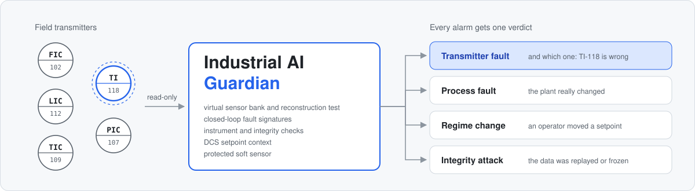
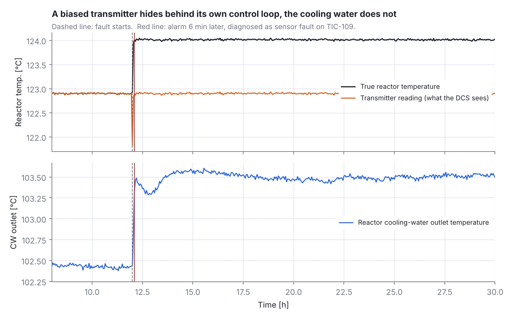
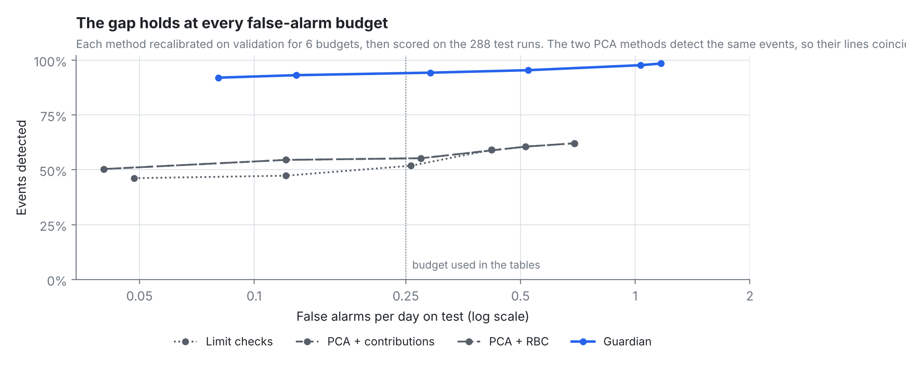
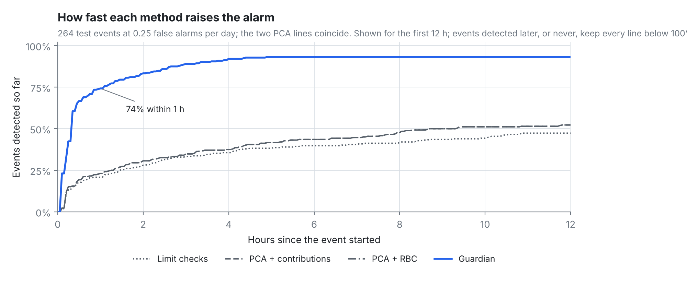
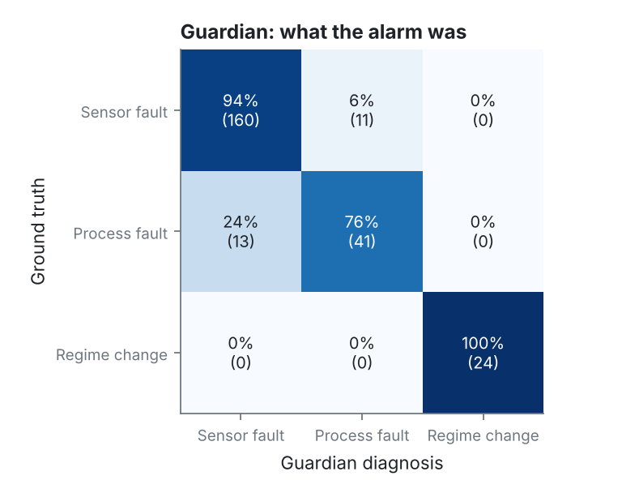
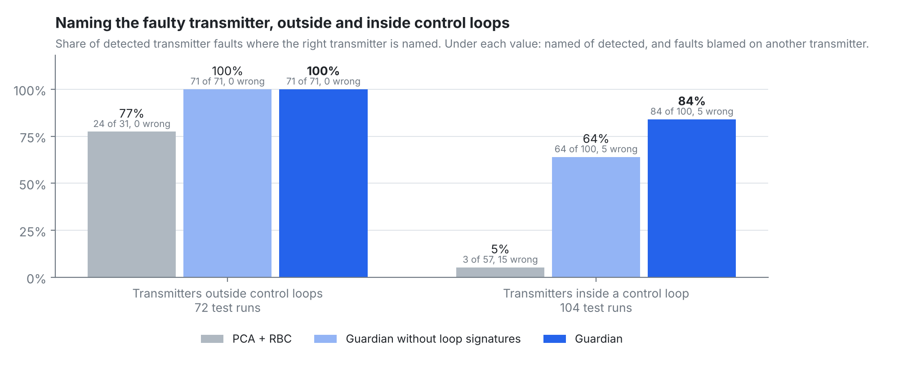
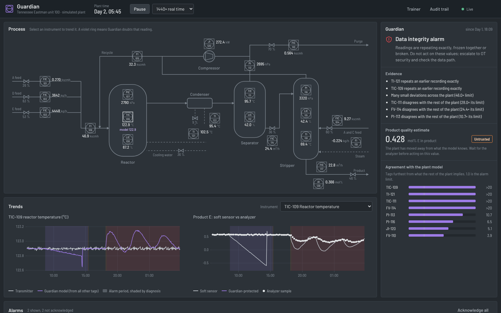
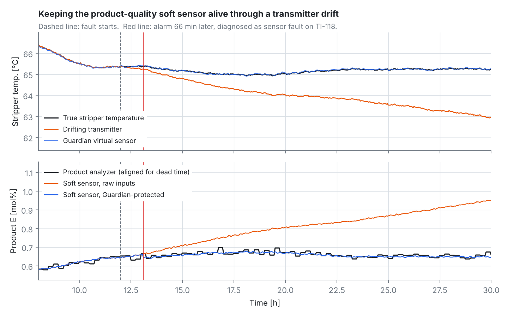
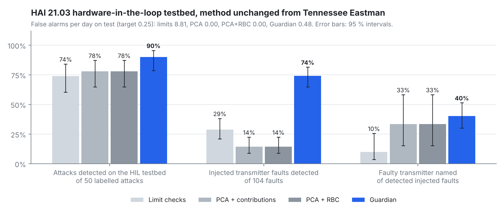

<div align="center">



# Industrial AI Guardian

**Fault and integrity monitoring for the transmitters behind industrial soft sensors.**

When an alarm comes in, Guardian tells the operator whether a transmitter has failed (and which one),<br>
the process itself has changed, or the data has been tampered with, and keeps the product-quality estimate usable while it does.

[](https://github.com/Tejascodz/industrial-ai-guardian/actions/workflows/ci.yml)
[](pyproject.toml)
[](CITATION.cff)
[](#benchmarks)
[](LICENSE)

[Overview](#overview) · [Quickstart](#quickstart) · [How it works](#how-it-works) · [Design decisions](#design-decisions) · [Benchmarks](#benchmarks) · [Usage](#usage) · [Related work](#related-work) · [Limitations](#limitations) · [Roadmap](#roadmap) · [Development](#reproducing-results-and-development) · [Security](#security) · [License](#license-and-citation)

</div>

<br>

<p align="center">
  
</p>
<p align="center"><sub>The live control room (<code>python -m dashboard</code>) during a drift on stripper temperature transmitter TI-118: Guardian names the transmitter, and the quality estimate keeps following the analyzer.</sub></p>

<table>
<tr>
<td align="center" width="33%">
<h3>94.3%</h3>
events detected<br>
<sub>249 of 264 test events, 95% CI 90.8–96.5%.<br>Best baseline: 55.3% (146 of 264).</sub>
</td>
<td align="center" width="33%">
<h3>91%</h3>
faulty transmitter named<br>
<sub>155 of 171 detected transmitter faults, 95% CI 85–94%.<br>79% without loop signatures. Best baseline: 33%.</sub>
</td>
<td align="center" width="33%">
<h3>42 / 42</h3>
integrity attacks detected<br>
<sub>14 attack types, 3 runs each, median delay 10.5 min.<br>Baselines: 38–40 of 42, median 30–33 min.</sub>
</td>
</tr>
<tr>
<td align="center" width="33%">
<h3>74% in 1 h</h3>
of events detected within an hour<br>
<sub>196 of 264 test events.<br>Baselines: 21–23%.</sub>
</td>
<td align="center" width="33%">
<h3>84%</h3>
in-loop transmitter faults named<br>
<sub>84 of 100 detected, 5 blamed on another tag.<br>PCA + RBC: 5% (3 of 57).</sub>
</td>
<td align="center" width="33%">
<h3>45 / 50</h3>
attacks detected on HIL testbed data<br>
<sub>HAI 21.03, method unchanged.<br>Baselines: 37–39 of 50.</sub>
</td>
</tr>
</table>

> [!NOTE]
> **How to read these numbers.**
> - All but the last tile come from a simulation: the closed-loop Tennessee Eastman process (NIST TESIM port, Ricker decentralized control). The last comes from recorded [hardware-in-the-loop data](#hardware-in-the-loop-data-hai-2103), which is still not a real plant, and naming the faulty transmitter is much weaker there.
> - Every method is calibrated to the same budget of 0.25 false alarms per day on a separate validation split. On test, Guardian's rate is the highest of the four (0.29 per day, against 0.26 to 0.27), with overlapping intervals.
> - The 288 test runs use seeds generated after the first version's design was frozen. The loop signatures added later were tuned on a separate development split.
> - To name transmitters inside control loops, Guardian uses fault signatures learned from extra simulated faults on the same simulator, which the baselines do not get. A real site would need a dynamic model of its loops for this.
> - Guardian misses 15 of 264 events and still reports most in-loop level transmitter faults as process faults. See [Limitations](#limitations).

## Overview

A soft sensor estimates a quality variable that cannot be measured online from the transmitters that can. If one of those transmitters drifts, the estimate drifts with it, and nothing in the control system says so. A transmitter inside a control loop is worse: the controller keeps its own reading on setpoint, so the faulty reading looks perfect while the real process moves. Guardian treats the plant's correlations as a second, independent opinion on every transmitter, and decides what kind of problem an alarm is before anyone acts on it.

- **Virtual sensor bank.** A ridge model for each of the 31 monitored tags predicts that tag from all the others, so a faulty transmitter never vouches for itself. A loop that hides a fault in its own measurement cannot hide it in the cooling water, the valve or the downstream flows.
- **Reconstruction test.** A transmitter fault is declared only if replacing that one transmitter by its virtual value explains every other residual. If no single tag does, the alarm is a process fault.
- **Closed-loop fault signatures.** Inside a loop, the controller hides a transmitter fault by moving the real process. Guardian learns, from simulated faults, the pattern each in-loop transmitter's fault leaves on the other tags, and names that transmitter when the residuals match its pattern and no other.
- **Distributed control system (DCS) context and instrument checks.** Recent setpoint moves mean the operating regime changed, not that a fault occurred. Flatline and noise checks catch stuck and noisy transmitters that correlations alone would miss.
- **Integrity checks.** Replayed data, several transmitters freezing at once, and broken values or timestamps raise an integrity alarm rather than a fault.
- **Protected soft sensor.** While a transmitter outside a loop is faulty, the soft sensor runs on that tag's virtual value. Every estimate carries a status: OK, RECONSTRUCTED or UNTRUSTED.

What ships: a Python library (`guardian`), a C++ plant simulator (`sim/te_cli`), a local live control room (`python -m dashboard`), a read-only OPC UA link (`scripts/opcua_demo.py`), a loader for the HAI testbed data (`guardian/hai.py`) and scripts that rebuild every result and figure in this README. Guardian takes its tag list, field transmitters, setpoints and sample period from a plant description (`guardian/plant.py`), so the same code runs on both plants.

### Evidence so far

| Level | Data | Status | Main result |
|---|---|---|---|
| Simulation | Closed-loop Tennessee Eastman, 288 test runs, 42 attack runs | Done | 94.3% of events detected, 91% of transmitter faults named, all 42 attacks detected |
| Hardware-in-the-loop | HAI 21.03: physical boiler, turbine and water-treatment rigs with a simulated power plant, 50 labelled attacks | Done | 90% of attacks and 74% of injected transmitter faults detected; transmitter named in 40% |
| Real process faults | Public data recorded on a real rig (candidate: the PRONTO benchmark from Cranfield University's multiphase flow facility) | Planned | |
| Live plant | Read-only connection to a running unit | Not done | |

## Quickstart

You need Python 3.11 or newer, a C++17 compiler and `make`.

```bash
git clone https://github.com/Tejascodz/industrial-ai-guardian
cd industrial-ai-guardian
python3 -m venv .venv && source .venv/bin/activate
make -C sim && pip install -e .
```

Generate the normal operating history that Guardian learns from, the validation runs used to calibrate its alarm limits, and the simulated in-loop faults it learns loop signatures from. This simulates 274 runs and took about 5 minutes on 2 CPU cores:

```bash
python scripts/generate_data.py --only train val sig
```

Inject a 1 °C bias on the stripper temperature transmitter and read Guardian's verdict:

```bash
python scripts/quickstart.py
```

```text
injected  bias of 1 degC on TI-118 (Stripper temperature) at t = 12 h
before    0 false alarm(s) in 10 h of normal operation
alarm     t = 12.10 h, 6 min after the fault
verdict   sensor fault on TI-118 (Stripper temperature)
1 h later sensor fault on TI-118 (Stripper temperature)
took 22 s
```

Try other faults with `--tag`, `--kind` (`bias`, `drift`, `stuck` or `noise`) and `--size`. For example, `python scripts/quickstart.py --tag xmeas_7 --kind stuck` freezes the reactor pressure transmitter PIC-107. To watch the plant live and inject faults by hand, run `python -m dashboard` and open the link it prints. See [Live control room](#live-control-room).

## How it works

<p align="center">
  
</p>

Every 3 plant minutes one sample arrives: the 22 field transmitters, the 9 valve outputs and the DCS setpoints. It goes through four steps.

### 1. Validate and repair

Each sample is checked for schema, finite values, instrument span and timestamps (`guardian/validation.py`). A broken value or timestamp raises the integrity channel `V`. Bad values are repaired one transmitter at a time, using past data only. A missing value holds that tag's last valid reading, and a value outside the span is clipped to the span limit, the way a saturated transmitter reads. One bad transmitter therefore never hides the readings of the others, nothing is filled backwards from the future, and an off-scale transmitter still raises an alarm.

### 2. Evidence channels

All channels are computed on data scaled with the normal history's mean and standard deviation.

| Channel | What it measures | Window |
|---|---|---|
| `R:<tag>`, `Q` | Exponentially weighted moving average (EWMA, λ = 0.2) of each virtual-sensor residual, and their sum | continuous |
| `N:<tag>` | Noise: high-frequency content of a transmitter's residual | 20 samples (60 min) |
| `F:<tag>` | Flatline: a transmitter that stopped moving | 5 samples (15 min) |
| `P:<tag>` | Replay: a window of readings that repeats exactly | 5 samples (15 min) |
| `T2` | Hotelling's T² of the operating point on PCA (90% of variance) | continuous |
| `ENV` | A setpoint outside the range seen in normal history | instantaneous |

The virtual sensor bank (`guardian/bank.py`) fits one ridge regression per tag, predicting it from every other tag at lags 0 to 2. Lags let a model follow loop dynamics. A tag's own present and past values are never inputs to its own model. That makes the residual an independent check, and it is what lets the reconstruction test work.

### 3. Alarm

A sample is hot when any channel exceeds its limit. An alarm needs 3 consecutive hot samples (9 minutes). Limits are set per channel family (all `R:` channels share one, all `N:` channels another, and so on) to give 0.25 false alarms per day on the validation split. One extreme quantile per channel did not carry over to new seeds; a few family limits do.

### 4. Diagnosis

The first rule that fires decides (`Guardian._instant` in `guardian/methods.py`):

| # | Evidence | Verdict |
|---|---|---|
| 1 | Broken or replayed data, or 3 or more transmitters frozen at the same moment | integrity attack |
| 2 | One transmitter flatlined (a live process never produces a flat signal) | sensor fault on that tag |
| 3 | A setpoint moved within the last 2 h, or is outside the validated envelope | regime change |
| 4 | Noise confined to one tag, at least twice the next noisiest | sensor fault on that tag |
| 5 | Replacing one anomalous tag by its virtual value brings every other residual back under its limit | sensor fault on that tag |
| 6 | The residuals lie in the closed-loop fault subspace of one in-loop transmitter: after projecting them onto it, every residual is back under its limit, and the next-best transmitter leaves at least twice as much | sensor fault on that tag |
| 7 | Otherwise | process fault |

Rule 6 exists because rule 5 fails inside loops. When a flow transmitter reads high, its controller closes the valve until the reading is back on setpoint, so the real flow drops and the deviation appears on the valve and on tags downstream. The per-tag models cannot predict that pattern, because in normal data a controlled flow barely moves. `Guardian.fit_signatures` learns it instead: from 104 simulated bias and drift faults on the 13 transmitters inside loops (`sig` split, seeds of its own, never scored), it keeps the main directions of the smoothed residuals after each fault (at most 2 per transmitter, 90% of their energy). 12 transmitters get a signature; a fault on the stripper level transmitter barely shows on the residuals. At diagnosis the residuals are reconstructed along each transmitter's directions, as in multidimensional fault reconstruction (Dunia and Qin, 1998). Signatures describe bias and drift, so rule 6 is skipped while any noise channel is above its limit. A plant without a dynamic simulator simply skips this step, and rule 6 never fires. It is also left out of the onset vote below: a signature describes the settled loop response, not the first minutes.

In closed loop, a transmitter fault makes the controller move the real process, so other tags start to deviate too. Guardian therefore fixes the root cause in the first 18 minutes of an alarm, if at least 90% of those samples agree on one transmitter, and keeps that verdict while the transmitter stays anomalous. Integrity evidence anywhere in the alarm always takes precedence.

<p align="center">
  
</p>

The figure shows why the bank looks beyond the faulty tag. The reactor temperature loop keeps the biased reading on setpoint, so the transmitter looks perfect, but the cooling water does not agree with it.

### Protected soft sensor

The soft sensor (`guardian/softsensor.py`) is a ridge model that estimates product composition E (analyzer AI-138, 15 min dead time) from the monitored tags. Its status follows the diagnosis:

- **OK:** no alarm.
- **RECONSTRUCTED:** a sensor fault on a transmitter outside any control loop. The estimate uses that tag's virtual value.
- **UNTRUSTED:** a process fault, a regime change, an attack, or a sensor fault inside a loop. In those cases the real process has moved, so no input repair can recover the true value.

## Design decisions

The choices that shape Guardian, why they were made, and what they cost.

| Decision | Why | Trade-off |
|---|---|---|
| A bank of linear ridge models, one per tag, instead of one deep network | Every residual belongs to one transmitter and can be explained to an operator. Fits in seconds on a CPU, needs no GPU at the plant, and a reconstruction test is a closed-form calculation | Linear models miss strongly nonlinear behaviour; the lags add some dynamics but did not measurably help here |
| A faulty tag never predicts itself | A transmitter cannot vouch for its own reading, so its residual is an independent check, and replacing it by its virtual value is a fair hypothesis test | Tags with no correlated neighbours cannot be checked this way |
| Alarm limits set by a false-alarm budget, one per channel family | Operators judge a monitor by its nuisance alarms (ISA-18.2). A few family limits held up on new seeds; one extreme quantile per channel did not | Guardian's false-alarm rate on test (0.29 per day) is slightly above the budget |
| Diagnosis by ordered rules, not a classifier | Each verdict names the evidence that produced it, and the order encodes what an engineer checks first: data integrity, then instruments, then operator moves, then the process | The order is fixed by hand. A case that two rules could explain gets the first one |
| Read-only, never in the control path | A monitor that can write to a DCS is an attack surface (IEC 62443). Guardian reads over encrypted OPC UA and signs its own models and audit log | It cannot add a watermark to the control signal, so replays with added noise are only caught as faults |
| Loop signatures optional, learned from a simulator | Inside a loop, normal data alone cannot tell a biased transmitter from a process change; a dynamic model of the loops can | They help only where such a model exists, and only as much as it matches the plant |
| Fixed test split, run once per method version, with every ablation reported | Numbers that were tuned on the test set say nothing about the next plant | Some negative results stay in the README, such as the dynamic bank not beating the static one |

## Benchmarks

### Setup

| | |
|---|---|
| Plant | Tennessee Eastman process (Downs and Vogel, 1993) with Ricker's decentralized control (1996), C++ port of NIST TESIM. One sample every 3 min, first 2 h discarded |
| Training | 30 normal runs of 48 h, with operator setpoint moves inside the normal envelope |
| Validation | 140 runs of 40 h (12 normal, 128 events). Used only to set alarm limits |
| Test | 288 runs of 40 h, event at hour 12: 24 normal; 176 transmitter faults (22 transmitters × bias, drift, stuck, noise × 2); 64 process disturbances (16 IDVs × 4); 24 regime changes (8 out-of-envelope setpoints × 3). Seed base 60000, generated after the design was frozen |
| Development | 310 runs of 40 h (seed base 30000) for changes made after the first test run. The loop signatures were designed and tuned here and on validation |
| Loop signatures | 104 runs of 20 h (seed base 40000): bias and drift, both signs, on each transmitter inside a control loop. Used only by Guardian, to learn its closed-loop fault signatures; never scored |
| Attacks | 42 runs: 6 replay attacks with and without attacker noise (5 hide a real valve move), several transmitters freezing at once, and a slow coordinated bias along the main correlation of normal data; 3 runs each |
| Baselines | Per-tag limit checks (DCS-style alarms); PCA T² and SPE with contribution plots (MacGregor and Kourti, 1995); PCA with reconstruction-based contributions (RBC) (Alcala and Qin, 2009). All four methods see the same scaled data, the same EWMA, the same 3-sample persistence and the same false-alarm budget |
| Scoring | Detected: an alarm that starts at or after the event (an alarm already on when the event begins does not count). Diagnosis is read 1 h after detection. Intervals: Wilson for proportions, exact Poisson for false-alarm rates, bootstrap for median delays |
| Hardware | CPU only; the simulation and all models are deterministic given the seeds |

Fault sizes are realistic instrument errors: a bias of 1 to 3 units, a drift of 2 to 4 units over 8 h, and noise of 1 to 3 units. One unit is 0.5 °C for temperatures, 2% of span for levels, 0.5% of reading for pressures and 1% of reading for flows.

### Main results

Test split, 288 runs. Numbers from `results/table_main.csv`.

<p align="center">
  
</p>

| Method | False alarms / day | Events detected | Median delay | Class correct (of detected) | Transmitter named (of detected sensor faults) | Trips warned |
|---|---|---|---|---|---|---|
| Limit checks | 0.26 (0.18–0.36) | 51.9% (45.9–57.9) | 1.60 h (1.10–2.45) | 48.2% (40.0–56.5) | 32.9% (23.2–44.3) | 16 / 20 |
| PCA + contributions | 0.27 (0.19–0.38) | 55.3% (49.3–61.2) | 1.60 h (1.00–2.35) | 39.0% (31.5–47.1) | 30.7% (22.0–41.0) | 16 / 20 |
| PCA + RBC | 0.27 (0.19–0.38) | 55.3% (49.3–61.2) | 1.60 h (1.00–2.35) | 45.2% (37.4–53.3) | 30.7% (22.0–41.0) | 16 / 20 |
| **Guardian** | 0.29 (0.20–0.40) | **94.3% (90.8–96.5)** | **0.30 h (0.25–0.35)** | **90.4% (86.1–93.4)** | **90.6% (85.3–94.2)** | **20 / 20** |

95% intervals in brackets. "Trips warned" counts plant shutdowns preceded by an alarm. Guardian's diagnosis uses the loop signatures learned from simulated faults; the baselines use normal data only. Without the signatures, Guardian's class is correct for 82.3% of detected events and the transmitter is named in 78.9% (see [Ablations](#ablations)). On the same 264 events, Guardian detects every event that any baseline detects, plus 103 to 112 events they miss (exact McNemar test, p < 10⁻³⁰; `results/table_paired.csv`). The trend holds at other budgets. At about 0.1 false alarms per day on test, Guardian detects 92 to 93% of events and the baselines detect 47 to 55% (`results/operating_curve.csv`).

<p align="center">
  
</p>

Speed matters as much as coverage: an operator can still act on an alarm in the first hour. Guardian detects 74% of all test events within 1 hour of their start (196 of 264); the baselines detect 21 to 23%.

<p align="center">
  
</p>

What each detected event was diagnosed as, 1 hour after the alarm:

<p align="center">
  
</p>

### Where the difference comes from

Transmitter faults inside and outside control loops (`results/table_loops.csv`):

| Transmitters | Runs | PCA + RBC: detected / named / wrong tag | Guardian without loop signatures | Guardian |
|---|---|---|---|---|
| Outside control loops | 72 | 43% / 77% / 0 | 99% / 100% / 0 | **99% / 100% / 0** |
| Inside a control loop | 104 | 55% / 5% / 15 | 96% / 64% / 5 | **96% / 84% / 5** |

"Named" is the share of detected faults where the right transmitter is named; "wrong tag" counts detected faults blamed on another transmitter. Inside a loop, classical isolation names the right tag in 3 of 57 detected faults. Guardian names it in 84 of 100, up from 64 without the loop signatures, and blames the wrong transmitter as often as before (5 times). Bias and drift on in-loop flow transmitters are now named in 26 of 28 detected cases, against 9 of 28 before (`results/table_inloop.csv`).

<p align="center">
  
</p>

By fault type, transmitter named among detected faults (`results/table_fault_type.csv`):

| Fault | PCA + RBC | Guardian |
|---|---|---|
| Stuck | 0% (0 / 22) | **100% (43 / 43)** |
| Noise | 17% (2 / 12) | **86% (38 / 44)** |
| Drift | 53% (18 / 34) | **88% (35 / 40)** |
| Bias | 35% (7 / 20) | **89% (39 / 44)** |

### Integrity attacks

Results from `results/table_attacks.csv` and `results/attack_summary.csv`.

| | Limit checks | PCA + RBC | Guardian |
|---|---|---|---|
| Attacks detected (42 runs) | 38 (90%) | 40 (95%) | **42 (100%)** |
| Median detection delay over attack types | 33 min | 30 min | **10.5 min** |
| Recognised as an attack, not a fault | 0 | 0 | 21 |
| Plant trips warned in advance | 17 / 19 | 17 / 19 | **19 / 19** |

| Attack (Guardian) | Detection delay | Recognised as an attack |
|---|---|---|
| Exact replay hiding a valve move (5 variants) | 9 to 18 min | 3 of 3 runs each |
| Exact replay of every transmitter | 6 min | 3 of 3 |
| The same replays with attacker noise (6 variants) | 6 to 21 min | 0: reported as a process or sensor fault |
| Several transmitters freeze at once | 18 min | 3 of 3 |
| Slow coordinated bias along the main correlation | 48 min (baselines: 15 to 26 h, or missed) | 0 |

Every attack is detected, but only exact replays and freezes are recognised as attacks. A replay with added noise defeats the exact-repetition check and is reported as a fault: the alarm still fires, but its label is wrong.

<p align="center">
  
</p>

### Protected soft sensor

Root-mean-square error (RMSE) of the product-E estimate against the dead-time-aligned analyzer, in mol% (`results/softsensor_summary.csv`). In normal operation it is 0.010.

| During transmitter faults | Raw inputs | Guardian-protected | Oracle (true transmitter values) |
|---|---|---|---|
| Outside control loops | 0.088 | **0.012** | 0.010 |
| Inside a control loop | 0.310 | 0.271 | 0.246 |

Outside a loop, protection brings the estimate back to normal accuracy. Inside a loop, even perfect inputs leave the error high, because the real process has moved. That is why those estimates are marked UNTRUSTED rather than repaired. Of the estimates whose error exceeds 3 times the normal RMSE, 99.4% carry a non-OK status. Among estimates marked OK, 0.31% exceed that error (`results/softsensor_flags.csv`).

<p align="center">
  
</p>

### Ablations

Each row removes one part of Guardian. The p-values are exact McNemar tests against full Guardian on the same 264 events (`results/table_ablation.csv`).

| Variant | Detected | Class correct | Transmitter named | Significant? |
|---|---|---|---|---|
| Guardian | 94.3% | 90.4% | 90.6% | |
| Without loop signatures | 94.3% | 82.3% | 78.9% | class yes (p < 10⁻⁵); detection unchanged |
| Without instrument checks | 88.6% | 72.2% | 63.1% | yes, detection p = 0.0003, class p < 10⁻¹² |
| Without setpoint context | 92.4% | 82.8% | 90.6% | class yes (p < 10⁻⁶); detection no (p = 0.06). Regime changes recognised: 5% instead of 100% |
| Static bank (no lags) | 95.1% | 87.6% | 88.8% | **no** (p = 0.63 and 0.36) |
| Without integrity layer | 94.3% | 90.4% | 90.6% | no difference on faults; attacks recognised: 0 instead of 21 |

### What did not work or is not significant

- **Lagged inputs.** The dynamic bank is no better than a static one on this benchmark. It remains the default because it was chosen before testing. Switching after seeing test results would be tuning on the test set.
- **False alarms.** Guardian has the highest false-alarm rate of the four methods on test (0.29 per day against 0.26 to 0.27), although every interval overlaps.
- **In-loop level transmitters.** With the loop signatures, Guardian names 84% of detected in-loop transmitter faults, but bias and drift on level transmitters are named in only 2 of 8 detected cases; the rest are reported as process faults. A biased level reading moves its loop so little that the fault barely shows on other tags (`results/table_inloop.csv`).
- **Loop signatures need a model of the loops.** They are learned from the same simulator that produces the test runs, so the model is perfect here. On a real plant they would come from a dynamic simulator or digital twin that differs from the plant, and the gain would be smaller. Without them, Guardian names 64% of in-loop faults.
- **Process faults blamed on a transmitter.** 13 of 54 detected process faults (24%) are blamed on a single transmitter, always a temperature (TI-118, TI-121 or TI-122). All 13 come from disturbances IDV(10), (14), (17) and (18) (`results/table_process_blamed.csv`).
- **Missed events.** Guardian misses 15 of 264 events (`results/guardian_misses.csv`): slow drifts on the separator and stripper level transmitters (4), one stuck stripper temperature transmitter, and the process disturbances IDV(5), (12) and (16) (10). Under this control strategy their effect on the monitored data stays within normal variation.
- **Retired test split.** An earlier test split (seed base 50000) was run once during development. It exposed the threshold-generalization problem that led to family-wise limits. Because it had influenced a design choice, it was retired, and the results above come from a fresh split that was run once. On the retired split Guardian detected 93.6% of events. The loop signatures (rule 6) were added after this test split had been run once. They were designed and tuned only on the validation and development splits, and the test split was then run once more. It is not fully untouched for this change, since the in-loop weakness was first seen on it; on the development split the same change raised in-loop naming from 65% to 86%.

### Hardware-in-the-loop data: HAI 21.03

To check that the method is not tuned to one simulator, it was run unchanged on [HAI 21.03](https://github.com/icsdataset/hai) (Shin et al., 2021), recorded from a hardware-in-the-loop testbed: three small physical processes (boiler, turbine and water treatment) under industrial controllers (Emerson Ovation, GE Mark VIe, Siemens S7-1500), coupled to a simulated steam-turbine power plant. Every Guardian setting is the one used on Tennessee Eastman; only the plant description (`guardian/hai.py`) is new. Windows are counted in samples, so at 10 s sampling they are 18 times shorter in time than on Tennessee Eastman.

| | |
|---|---|
| Data | 1 s data averaged to 10 s. 31 field transmitters and 17 controller outputs monitored, 6 setpoints used as DCS context |
| Fit and calibrate | Fit on `train1` and `train2` (176 h of normal operation). Alarm limits set on `train3` (80 h) for 0.25 false alarms per day |
| Attacks | `test1` to `test5`, 112 h with 50 labelled attacks, timed against the dataset's published attack table. An attack counts as detected if an alarm starts between its first labelled sample and 10 min after its last; any other alarm is a false alarm |
| Injected transmitter faults | Semi-synthetic: bias (4σ), drift (to 6σ over 1.5 h), stuck and noise (2σ) added to 3 h stretches of normal test data, 30 min or more away from any attack. σ is the transmitter's median standard deviation over 1 h of normal data. 13 transmitters outside every feedback loop × 4 kinds × 2 = 104 runs, seed 2103 |

Results from `results/hai_summary.csv`, 95% intervals in brackets:

| Method | False alarms / day on test | Attacks detected | Median delay | Injected faults detected | Transmitter named (of detected) | Wrong transmitter blamed |
|---|---|---|---|---|---|---|
| Limit checks | 8.8 (6.2–12.1) | 74% (60–84) | 50 s | 29% (21–38) | 10% (3–26) | 40% |
| PCA + contributions | 0 (0–0.9) | 78% (65–87) | 50 s | 14% (9–22) | 33% (15–58) | 0% |
| PCA + RBC | 0 (0–0.9) | 78% (65–87) | 50 s | 14% (9–22) | 33% (15–58) | 0% |
| **Guardian** | 0.48 (0.06–1.72) | **90% (79–96)** | 40 s | **74% (65–82)** | 40% (30–51) | 2.6% |

<p align="center">
  
</p>

What this shows, and what it does not:

- **Detection carries over.** With no retuning, Guardian detects 45 of the 50 attacks and 77 of the 104 injected faults. The baselines detect 37 to 39 attacks and 15 to 30 injected faults.
- **Naming the transmitter does not carry over well.** Guardian names the right transmitter in 31 of 77 detected injected faults (40%), against 79% on Tennessee Eastman without loop signatures. HAI runs without them: there is no simulator of the testbed to learn them from, and the injected faults are outside loops anyway. By kind: bias 12 of 21, stuck 9 of 17, noise 8 of 21, drift 2 of 18. Most of the rest are reported as process faults or regime changes, and only 2 blame the wrong transmitter. Three transmitters are rarely detected at all: P1_FCV03Z (1 of 8), P1_PIT02 and P4_ST_TT01 (3 of 8 each).
- **False alarms are above target.** 2 false alarms in 4.2 days of test data, 0.48 per day against a target of 0.25; the interval is wide (0.06 to 1.72). The PCA baselines have none, but they also detect far fewer faults. Limit checks, calibrated the same way, give 8.8 per day.
- **No HAI attack is recognised as an attack.** HAI's attacks change setpoints and controller outputs. Where an attack also hides a sensor, it does so on the operator's screen only: in the recorded data that sensor still reports the real process. Nothing in the data is replayed or frozen, so Guardian's integrity checks have nothing to find. It reports 30 of the 45 as process faults and blames a transmitter in 14 (31%), which here is a false blame. PCA with contributions does the same in 31% of its detections.
- **Not a real plant, and not a contest score.** The rigs are real but the power plant is simulated. The injected faults are added to recorded data, so they only use transmitters outside feedback loops: a fault injected into a loop's own transmitter in recorded data would not make the controller react. Detection is scored per attack, not with the eTaPR metric that HAI recommends, so these numbers are not comparable to HAI contest results.

HAI 21.03 is published under [CC BY-SA 4.0](https://github.com/icsdataset/hai#license) (the licence stated in the dataset's README) and is not redistributed here: `scripts/fetch_hai.py` downloads it from the dataset's repository at a pinned commit and checks every file's SHA-256 hash.

## Usage

### Commands

| Command | What it does |
|---|---|
| `python scripts/generate_data.py [--only SPLIT ...] [--jobs N]` | Simulate the train, val, test, dev and sig splits and the attack splits into `data/` (Parquet). `--jobs` defaults to all cores |
| `python scripts/quickstart.py [--tag xmeas_N] [--kind K] [--size X] [--seed S]` | Fit Guardian, inject one fault into a fresh run, print the verdict |
| `python -m dashboard [--port 8050] [--seed 7] [--no-browser]` | Live control room on `127.0.0.1` (needs the train and val splits; uses the sig split if present) |
| `python scripts/run_benchmark.py [--target-fa 0.25] [--only TEXT]` | Fit, calibrate and score every method and variant on the test splits |
| `python scripts/run_softsensor.py` | Soft-sensor accuracy and status flags |
| `python scripts/summarize_results.py` | Tables with confidence intervals and significance tests (`results/table_*.csv`) |
| `python scripts/make_figures.py` | Every figure in `docs/figures/` from `results/` and `data/` |
| `python scripts/export_model.py [--out models/guardian]` | Fit, calibrate and save an HMAC-signed model (needs `GUARDIAN_KEY`) |
| `python scripts/opcua_demo.py [--scenario NAME]` | Replay a test run over an encrypted, read-only OPC UA link into a signed model, with a verified audit log |
| `python scripts/fetch_hai.py` | Download HAI 21.03 (about 180 MB) into `data/hai/` and verify its SHA-256 hashes |
| `python scripts/run_hai.py` | Fit, calibrate and score every method on HAI 21.03 (`results/hai_*.csv`) |

| Environment variable | Used by | Meaning |
|---|---|---|
| `GUARDIAN_KEY` | `export_model.py`, `opcua_demo.py`, `dashboard` | HMAC key (at least 16 characters) that signs models and the audit log. There is no default. Without it, the dashboard fits a fresh model and signs its audit log with a random key for that session |

### Library

Fit, calibrate and diagnose one validation run (after `generate_data.py --only train val sig`):

```python
from guardian.evaluate import calibrate, persisted, prepare
from guardian.features import load_split, runs, signature_runs
from guardian.methods import Guardian
from guardian.sim import NORMAL

train, _ = load_split("train")
val, meta = load_split("val")
vr = list(runs(val))
g = Guardian().fit([r for _, r in runs(train)], [r for n, r in vr if meta[n]["event_class"] == NORMAL])
g.fit_signatures(signature_runs())                 # closed-loop fault signatures (optional)
limits, _ = calibrate(prepare(g, vr, meta), 0.25)  # 0.25 false alarms per day on validation

name, run = next((n, r) for n, r in vr if n == "val_sf_xmeas_9_bias_0")
a = g.analyze(run)                                 # evidence channels, one row per sample
alarm = persisted((a.S > limits).any(axis=1))      # 3 consecutive samples above a limit
i = int((alarm & (run.time >= meta[name]["event_t"])).argmax())  # first alarm after the fault
print(f"{name}: alarm at t = {run.time.iloc[i]:.2f} h ->", g.diagnose(a, i, limits))
```

```text
val_sf_xmeas_9_bias_0: alarm at t = 12.10 h -> ('sensor_fault', 'xmeas_9')
```

`g.analyze(run)` takes a DataFrame with `time`, `xmeas_*`, `xmv_*` and `sp_*` columns, one row per 3-minute sample. `scripts/quickstart.py` shows the same steps on a freshly simulated run.

### Live control room

The screenshot at the top of this page shows it. `python -m dashboard` starts a local, ISA-101 style control room around the running simulator. The flowsheet uses ISA-5.1 tag names, alarms follow ISA-18.2 states with four priorities, and every alarm, acknowledgement and trainer action is written to the HMAC-chained audit log. The trainer panel injects transmitter faults, process disturbances, setpoint moves and integrity attacks into the live plant. "Show what was injected" reveals the ground truth. Until then, the server does not send it at all.

<details>
<summary>WebSocket command reference</summary>

The browser and server talk over one WebSocket at `/ws?token=…`. Every message is JSON, validated against a strict schema: unknown fields, NaN and infinity are rejected, messages are capped at 4 KB, and each connection gets a burst of 10 commands refilled at 5 per second.

| `cmd` | Fields | Effect |
|---|---|---|
| `run` | `running: bool` | Pause or resume the plant clock |
| `speed` | `value: float` | Plant speed relative to real time |
| `reset` | `seed: int` (1 to 1,000,000) | Restart the plant |
| `setpoint` | `name: str`, `value: float` | Move a DCS setpoint (range-checked per setpoint) |
| `fault` | `tag: "xmeas_N"`, `kind: bias \| drift \| stuck \| noise`, `magnitude: float` | Inject a transmitter fault |
| `clear_faults` | | Remove all transmitter faults |
| `disturbance` | `idv: int` (1 to 20), `on: bool` | Start or stop a process disturbance |
| `attack` | `preset: str`, `jitter: bool` | Start an integrity attack preset |
| `stop_attacks` | | Stop all attacks |
| `ack` | `id: int` (optional) | Acknowledge one or all alarms |
| `reveal` | `on: bool` | Send or withhold ground truth |
| `audit` | | Return the last 200 audit records and the chain verification result |

</details>

## Related work

| Work | What it does | How Guardian relates |
|---|---|---|
| Multivariate statistical process control: T², SPE and contribution plots ([MacGregor and Kourti, 1995](https://doi.org/10.1016/0967-0661%2895%2900014-L); [Qin, 2003](https://doi.org/10.1002/cem.800)) | Detects abnormal operation with a PCA model of normal data, and points to likely variables through contributions | The baseline "PCA + contributions". Guardian uses the same EWMA and alarm budget, so the comparison isolates the diagnosis |
| Sensor fault identification by reconstruction ([Dunia et al., 1996](https://doi.org/10.1002/aic.690421011)) | Reconstructs each variable from a PCA model, and identifies the sensor whose reconstruction removes the fault | Guardian's rule 5 is the same hypothesis test, applied to a bank of per-tag regression models with lags rather than one PCA model |
| Multidimensional fault reconstruction ([Dunia and Qin, 1998](https://doi.org/10.1002/aic.690440812)) | Describes each fault by a subspace of directions and identifies it by reconstructing along each candidate subspace | Guardian's rule 6 reconstructs the bank residuals along a fault subspace per in-loop transmitter, learned from simulated closed-loop faults |
| Reconstruction-based contributions ([Alcala and Qin, 2009](https://doi.org/10.1016/j.automatica.2009.02.027)) | Fixes the smearing of contribution plots for single-sensor faults | The baseline "PCA + RBC". It works well outside loops but names only 5% of in-loop transmitter faults here |
| Self-validating inferential sensors ([Qin, Yue and Dunia, 1997](https://doi.org/10.1021/ie960615y)) | Validates the inputs of a soft sensor and reconstructs a faulty input before predicting | The closest prior idea to Guardian's protected soft sensor. Guardian adds closed-loop context (UNTRUSTED when the process itself moved), setpoint and instrument checks, and integrity checks |
| Tennessee Eastman benchmarks ([Downs and Vogel, 1993](https://doi.org/10.1016/0098-1354%2893%2980018-I); [Ricker, 1996](https://doi.org/10.1016/0959-1524%2896%2900031-5); [Rieth et al., 2017](https://doi.org/10.7910/DVN/6C3JR1)) | The standard simulated plant and widely used fault datasets, which cover process disturbances (IDVs) | Guardian uses the same plant and control strategy, adds transmitter faults injected inside the loop, regime changes and attacks, and scores diagnosis as well as detection |
| Replay attack detection ([Mo and Sinopoli, 2009](https://doi.org/10.1109/ALLERTON.2009.5394956)) | Detects replayed measurements by adding a small watermark to the control input | Guardian only reads, so it cannot add a watermark. Its exact-repetition check is weaker: replays with attacker noise get through it (see above) |
| Attacks on the Tennessee Eastman process ([Krotofil and Cárdenas, 2013](https://doi.org/10.1007/978-3-642-41488-6_12)) | Studies how integrity and denial-of-service attacks on sensors affect the plant | Inspired the replay, freeze and stealthy-bias attack scenarios used here |
| HAI dataset ([Shin et al., 2021](https://github.com/icsdataset/hai)) | Hardware-in-the-loop testbed data with labelled attacks on setpoints and controller outputs, for anomaly detection research | Used unchanged as a second benchmark. Guardian is scored on detection and on whether it falsely blames a transmitter, not with the dataset's eTaPR metric |
| Process change, instrument fault and data-path corruption ([Klymenko, 2026](https://arxiv.org/abs/2610.18904)) | A preprint that separates the same three causes with a bank of classical detectors and deterministic attribution, evaluated on injected events and the SKAB rig data | The closest prior work found. Guardian differs in its cross-tag reconstruction test, DCS setpoint context and protected soft sensor, not in the idea of the three-way split |
| Commercial predictive analytics, e.g. [AVEVA Predictive Analytics](https://www.aveva.com/en/perspectives/blog/predictive-analytics/) | Vendor material says it can flag bad sensors and exclude them from calculations and models | Bad-sensor handling exists in industry. Guardian is an open research prototype whose results can be rebuilt and checked, not a replacement for such products |

Guardian does not introduce a new statistical method. Its contribution is the combination: per-tag virtual sensors with a reconstruction test, closed-loop and DCS context, integrity checks and a protected soft sensor, evaluated together against classical baselines on a simulated plant and on hardware-in-the-loop data, with every result reproducible from this repository.

## Limitations

- **No real plant data.** Results come from a simulation (Tennessee Eastman) and a hardware-in-the-loop testbed (HAI 21.03). Transmitter faults on HAI are injected into recorded data, outside feedback loops only. A real unit adds historian compression, missing data, maintenance periods, recalibrations and slow ageing. All of these are untested.
- **Small scale.** 31 monitored tags on Tennessee Eastman and 48 on HAI. Plants with hundreds of tags, or several units, are untested.
- **Transfer to a new plant.** On HAI, detection carried over but naming the faulty transmitter fell from 79% (Tennessee Eastman, without loop signatures) to 40% of detected faults, and false alarms ran at 0.48 per day against a target of 0.25 (see [Hardware-in-the-loop data](#hardware-in-the-loop-data-hai-2103)).
- **Single faults.** Each event is one fault, disturbance or attack. Simultaneous faults are not evaluated.
- **In-loop transmitters.** Naming them relies on fault signatures learned from a simulator of the same plant. Bias and drift on in-loop level transmitters are still mostly reported as process faults (see [What did not work](#what-did-not-work-or-is-not-significant)).
- **Fixed models.** Guardian is fitted once on normal history. It does not adapt to slow plant changes, and retraining is manual.
- **Attacks that know the plant.** An attacker who can make every transmitter consistent with the plant's physics, or who adds noise to a replay, is not recognised as an attacker. The alarm still fires, but it is labelled as a fault.
- **Not a safety system.** Guardian never acts on the plant and must not be placed in a control or safety path.

## Roadmap

Each item is a separate change, with its own development split and a single run on held-out data.

| Next step | What it adds | How it will be judged |
|---|---|---|
| Real process faults | The PRONTO benchmark, recorded on a real multiphase flow rig, where every fault is a process fault | How often Guardian wrongly blames a transmitter on real data |
| Historian data | Import from historian exports, and a check of how much each tag was compressed (swinging-door compression removes the noise that limits are built on) | False alarms per day as compression increases |
| Scale and drift | Sparse models for hundreds of tags, and retraining that is only accepted after a shadow period | Fit time and false alarms on a larger tag set; no silent retraining during a fault |
| Several faults at once | Reconstruction over pairs of transmitters | Both transmitters named, without more false blame on single faults |
| Replays with added noise | A check that the controller's action and the measured response still agree | Noisy replays recognised as attacks, not faults |
| Calibrated alarms | A stated false-alarm guarantee per day, from conformal calibration on blocks of normal data | Test false alarms inside the stated bound |

## Reproducing results and development

The full pipeline, in order. Each step reads the previous step's output.

```bash
python scripts/generate_data.py          # all splits (train, val, test, dev, sig) and attack splits into data/
python scripts/run_benchmark.py          # results/benchmark_*.csv, operating_curve.csv, attack_*.csv
python scripts/run_softsensor.py         # results/softsensor_*.csv
python scripts/summarize_results.py      # results/table_*.csv, guardian_misses.csv
python scripts/make_figures.py           # docs/figures/*.png

python scripts/fetch_hai.py              # HAI 21.03 into data/hai/ (download, hash-checked)
python scripts/run_hai.py                # results/hai_*.csv, about 1 minute on 2 cores
```

`data/` is not committed. It is regenerated from seeds and is deterministic. `results/` is committed, so the tables and the hero chart can be checked without rerunning the simulation. CI runs `summarize_results.py` and fails if the committed tables change.

Tests and lint:

```bash
pip install -e ".[dev]"
make -C sim            # some tests run the simulator
pytest -q              # unit, security, OPC UA and dashboard tests
ruff check .
bandit -q -r guardian scripts dashboard
pip-audit -r requirements.txt
```

`requirements.txt` pins the exact versions the results were produced with. `pyproject.toml` gives the supported ranges.

```text
guardian/      library: plant descriptions, simulator driver, scenarios, validation,
               virtual sensor bank, methods (Guardian and baselines), evaluation,
               statistics, soft sensor, audit log, signed artifacts, OPC UA client
               and server, HAI loader
dashboard/     live control room: simulation engine, FastAPI + WebSocket server, static HMI
sim/           C++ Tennessee Eastman simulator (NIST TESIM) and the te_cli driver
scripts/       data generation, benchmark, soft sensor, tables, figures, model export, demos
tests/         pytest suite
results/       committed benchmark outputs and tables
docs/figures/  figures used in this README
```

## Security

Guardian is designed as a read-only monitoring layer. IEC 62443 is the reference for its design, not a certification: nothing here has been assessed by a certification body.

| Area | Default |
|---|---|
| Plant link | OPC UA SignAndEncrypt only (Aes256Sha256RsaPss, Basic256Sha256). X.509 certificates on both sides. The server's read-only permission ruleset refuses writes, even from a trusted client |
| Input | Schema, finite-value, span and timestamp checks before any model sees a sample |
| Models | No pickle. Arrays load with `allow_pickle=False`, and an HMAC-signed SHA-256 manifest is checked first. Loading requires the key |
| Audit | HMAC-SHA256 hash-chained log of every alarm, diagnosis change and action. Thread-safe, verified as a stream |
| Dashboard | Binds to `127.0.0.1` and answers only `127.0.0.1` or `localhost` host names. A random access token is compared in constant time. Origin check on the WebSocket, strict command schema with rate limits, Content-Security-Policy with no third-party code. Ground truth is withheld until revealed |
| Supply chain | Pinned dependencies. `bandit`, `pip-audit`, `detect-secrets` and `ruff` run in CI |

<details>
<summary>Threat model: threats, controls and the tests that verify them</summary>

| # | Threat (STRIDE) | Control | Verified by |
|---|---|---|---|
| T1 | Spoofed client reads plant data (S, I) | Certificate-based client identity; unknown certificates get no rights | `tests/test_opcua.py::test_server_refuses_unknown_certificates` |
| T2 | Eavesdropping or tampering on the wire (T, I) | OPC UA SignAndEncrypt only; a server offering no security is refused | `test_server_refuses_unencrypted_sessions` |
| T3 | Monitor used to write to the plant (E) | No write method in the client; read-only permission ruleset on the server | `test_server_refuses_writes_even_from_a_trusted_client` |
| T4 | Replayed sensor data hides an attack (T) | Exact-repetition detector on every transmitter (`P:` channels) | `results/attack_summary.csv`, `test_replay_detector_flags_repeated_windows_only` |
| T5 | Several transmitters frozen: lost link or denial of service (D) | Simultaneous flatline on 3 or more transmitters raises an integrity alarm | `results/attack_summary.csv` |
| T6 | Malformed data (T, D) | Schema, finiteness, span and time checks; per-transmitter repair from past data only | `tests/test_security.py` |
| T7 | Malicious model file (T, E) | No pickle; signed manifest checked before loading; key required | `test_artifact_tampering_is_refused`, `test_artifact_load_needs_a_key_unless_explicitly_unsigned` |
| T8 | Rewriting alarm history (R) | HMAC hash chain; any edit, deletion or reordering breaks verification; writes serialised by a lock | `test_audit_log_detects_tampering`, `test_audit_log_stays_consistent_under_concurrent_writers` |
| T9 | Vulnerable dependencies (T, E) | Pinned versions; `pip-audit` in CI | CI |
| T10 | Code-level flaws (E) | `bandit` and `ruff` in CI; the only subprocess runs the bundled simulator with fixed arguments and no shell | CI |
| T11 | Alarm flooding erodes trust (D) | Limits set to a false-alarm budget; 3-sample persistence; diagnosis debounced in the HMI | `results/table_main.csv` |
| T12 | Another local user or web page drives the dashboard (S, E) | Localhost binding and host check; random token; WebSocket origin check | `tests/test_dashboard.py` |
| T13 | Malformed or abusive commands (T, D) | Strict schema, range checks, 4 KB cap, per-connection rate limit | `tests/test_dashboard.py` |
| T14 | Script injection into the operator's browser (T, E) | CSP `script-src 'self'`, no inline script, vendored uPlot and fonts, server strings set with `textContent`, `frame-ancestors 'none'` | `test_page_has_strict_security_headers` |
| T15 | Ground truth leaks into a blind demo (I) | True values and injected faults stay on the server until revealed; the reveal is audited | `test_ground_truth_stays_on_the_server_until_revealed` |
| T16 | Malformed input to the simulator (T, D) | Strict, bounded number parsing in batch and live mode | `test_simulator_refuses_non_finite_and_out_of_range_numbers` |
| T17 | Secrets committed to the repository (I) | `.gitignore` covers keys, certificates and `.env` files; `detect-secrets` in CI | CI |

IEC 62443-3-3 foundational requirements:

| Requirement | How it is addressed |
|---|---|
| FR1 Identification and authentication control | X.509 application certificates on both sides of the OPC UA link (T1) |
| FR2 Use control | Read-only permission ruleset; least privilege for the monitoring identity (T3) |
| FR3 System integrity | Replay, freeze and validation checks; signed model artifacts (T4 to T7) |
| FR4 Data confidentiality | Encrypted OPC UA sessions; private keys written with 0600 permissions (T2) |
| FR5 Restricted data flow | One-way architecture with no write path; a data diode is recommended |
| FR6 Timely response to events | Integrity alarms within minutes; audit trail for investigation (T8) |
| FR7 Resource availability | Freeze and denial-of-service detection (T5); Guardian is outside the control path |

Not covered: physics-aware attacks, OS hardening of the host, enterprise key management (a site would use its certificate authority and a secret store), audit-log rotation, and authentication of the trainer panel beyond a local token. The trainer exists only because the plant is a simulator.

</details>

**Reporting a vulnerability:** please use GitHub's [private vulnerability reporting](https://github.com/Tejascodz/industrial-ai-guardian/security/advisories/new) rather than a public issue. See [SECURITY.md](SECURITY.md).

## License and citation

Released under the [MIT License](LICENSE). The Tennessee Eastman simulator in `sim/te/` is the NIST TESIM port ([usnistgov/tesim](https://github.com/usnistgov/tesim)), a work of the US Government that is not subject to copyright in the United States ([notice](sim/te/NIST_LICENSE.md)). The dashboard vendors [uPlot](https://github.com/leeoniya/uPlot) (MIT) and the Barlow typeface (SIL Open Font License); both licences ship next to the files in `dashboard/static/`. The HAI 21.03 dataset (National Security Research Institute, CC BY-SA 4.0) is downloaded by `scripts/fetch_hai.py`, not included; if you use it, cite H.-K. Shin, W. Lee, J.-H. Yun and B.-G. Min, "Two ICS Security Datasets and Anomaly Detection Contest on the HIL-based Augmented ICS Testbed", CSET '21, ACM, 2021, pp. 36–40.

To cite this work, use the metadata in [CITATION.cff](CITATION.cff); GitHub shows it under "Cite this repository".
