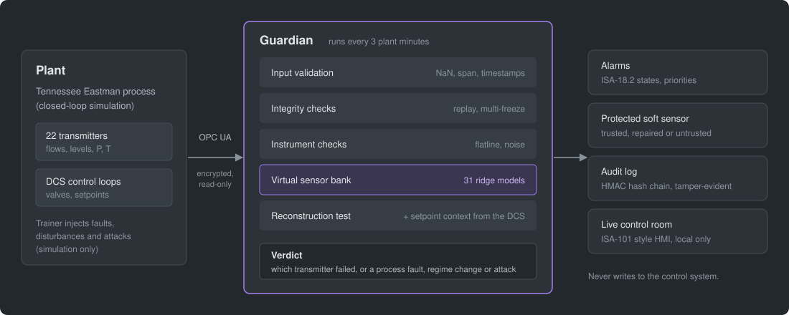

# How Guardian works

Guardian reads the same data the DCS has: transmitter readings, controller
outputs (valve positions) and setpoints. It never writes anything back.
Every 3-minute sample passes through the stages below. The code is in
`guardian/methods.py` (class `Guardian`) and `guardian/bank.py`.

## 1. Input validation

`guardian/validation.py` checks every sample before any model sees it:

- schema (required tags, numeric)
- finite values
- instrument span
- strictly increasing timestamps with no gaps

Broken data (NaN, bad time) raises an integrity alarm, and invalid samples
are masked. A value outside the span is reported but not treated as an
attack, because a real upset can saturate an instrument.

## 2. Virtual sensor bank (analytical redundancy)

For each of the 31 monitored tags (22 field transmitters and 9 active valve
outputs), a ridge regression predicts the tag from every *other* tag, using
their current and two previous samples. The tag never appears in its own
model, so a faulty transmitter cannot vouch for itself. The models are
fitted on normal history only. Residuals are scaled with held-out normal
data and EWMA-filtered (λ = 0.2).

## 3. Instrument checks

- **Flatline.** A live process never produces a perfectly flat signal. A
  transmitter whose sample-to-sample changes vanish is stuck.
- **Noise.** Excess high-frequency content in one tag's residual means a
  noisy transmitter. Real process variability shows up across physically
  related tags, so the check only blames a tag whose noise is at least twice
  that of any other.

## 4. Integrity checks

- **Replay.** Real transmitter noise never repeats. A 15-minute window of
  readings that matches an earlier window exactly means replayed data.
- **Freeze.** Three or more transmitters going flat at the same moment means
  a lost link or a denial of service; a real plant's saturating loops freeze
  one by one.

## 5. Diagnosis by reconstruction

When an alarm is raised, Guardian tests one hypothesis per transmitter k.
It replaces k with its virtual sensor and recomputes every other residual.
If that one replacement brings all other residuals back under their limits,
and k itself is anomalous, k is the suspect. This extends the
reconstruction-based identification of Dunia & Qin (1996) from a PCA model
to a regression bank.

The rules are applied in this order:

1. Integrity evidence (broken, replayed or simultaneously frozen data).
2. Flatline on one transmitter: sensor fault.
3. Setpoint outside the validated range, or moved within the last 2 h:
   regime change. Guardian reads setpoints from the DCS, because a regime
   change is something the operators did.
4. Noise confined to one transmitter: sensor fault.
5. Reconstruction test: sensor fault on the tag that explains everything.
6. Otherwise: real process fault.

**Root cause before propagation.** In closed loop a transmitter fault makes
the controller move the real process, so other tags deviate too. If one
transmitter consistently explained the alarm during its first 18 minutes,
and is still anomalous, later spread is treated as propagation of that
fault.

## 6. Protecting the soft sensor

The soft sensor estimates product component E from the 31 live readings.

| Guardian's verdict | Soft sensor status |
|---|---|
| No alarm | Trusted |
| Fault on a transmitter outside control loops | Repaired: the virtual sensor replaces the faulty input |
| Fault on a transmitter inside a control loop | Untrusted. The controller has moved the real plant, so the model is extrapolating even with correct inputs. |
| Process fault, regime change, integrity alarm | Untrusted |

## 7. Alarms

- An alarm needs 3 consecutive samples (9 min).
- Limits are calibrated on validation data to a fixed false-alarm budget.
- In the live dashboard, a changed diagnosis must hold for 3 samples before
  the alarm is re-diagnosed, and alarms follow the ISA-18.2 states (active or
  cleared, acknowledged or not).

## Where it fails

- **Some process faults are indistinguishable from a transmitter fault with
  this instrumentation.**
  - IDV(10) appears only in the stripper temperature.
  - IDV(17) and IDV(18) appear only in single cooling-water temperatures.
  - IDV(14) appears in TI-121 and TIC-109.

  All the process faults blamed on a transmitter (27 % of detected process
  faults) come from these four. Separating them needs one more measurement,
  such as feed or cooling-water inlet temperature. The isolability analysis
  doubles as an instrumentation recommendation.
- **Reactor temperature (TIC-109) faults.** A drift is isolated to the
  cooling-water outlet transmitter (TI-121): both hypotheses explain the fast
  data, and telling them apart needs the slow composition response. A large
  bias usually reads as a real process change, because the loop moves the
  reactor so far that no single-transmitter explanation fits.
- **Feed-flow transmitter faults inside flow loops** are often called process
  faults, because the ratio and cascade structure spreads the effect within
  minutes.
- **Undetected:** bias on the separator and stripper level transmitters,
  which the level loop absorbs, and IDV(5), IDV(12) and IDV(16).
- **Careful attackers.** Replays with attacker-added noise, and the stealthy
  bias, are detected but reported as faults. A data-driven monitor cannot
  prove intent.
- **Simulation only.** Nothing here is validated on plant data.
